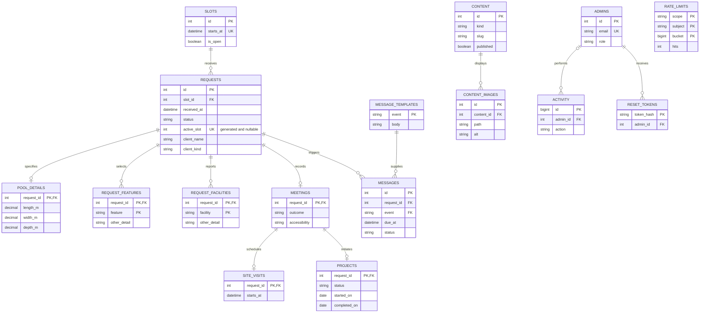

# Database design and normalization

Prime Pool Peninsula needs one record of each appointment from receipt through review, consultation and project tracking. Visitors browse published company content and send requests. Staff handle bookings, visits, projects and content. The owner manages staff access. The main write workload is short booking and status transactions. Read workloads include availability, filtered inbox and projects, print batches, dashboard counts, published content and message history.

The physical schema is in [schema.sql](../database/schema.sql). Setup also applies the [field integrity checks](../database/integrity.php) to fresh and existing databases. Strong domain entities include Slot, Request, Admin, Content and MessageTemplate. PoolDetails, Meeting, SiteVisit and Project use their parent key as their identifying key. Feature and Facility selections have identifying composite keys. Each request participates in exactly one slot. One slot can have several historical requests but at most one active request. An approved request can have zero or one meeting. A meeting can have zero or one site visit, and zero or one project. Projects require a proceeding outcome. Owner and staff form a total, disjoint specialization of Admin, implemented with its role discriminator. Company, service and portfolio entries form a total, disjoint specialization of Content using kind. A client may be an individual or a company on each form. A company request must include a contact person. Contacts are recorded as submitted for each request, since a mobile number is not a reliable client identifier.

## Relational keys and integrity

| Relation | Primary key | Other candidate keys and relationships |
| --- | --- | --- |
| setup_state | name | Records one-time installation steps |
| admins | id | email |
| slots | id | starts_at |
| requests | id | slot_id → slots, restrict. active_slot is a nullable conditional unique constraint |
| pool_details | request_id | request_id → requests, cascade |
| request_features | request_id, feature | request_id → requests, cascade |
| request_facilities | request_id, facility | request_id → requests, cascade |
| meetings | request_id | request_id → requests, restrict |
| site_visits | request_id | request_id → meetings, cascade |
| projects | request_id | request_id → meetings, restrict |
| content | id | kind, slug |
| content_images | id | content_id, path. content_id → content, cascade |
| message_templates | event | event is the stable template name |
| messages | id | request_id, event, occurrence. Both foreign keys restrict deletion |
| activity | id | admin_id → admins, set null |
| reset_tokens | token_hash | admin_id → admins, cascade |
| rate_limits | scope, subject, bucket | subject is a hash of an account, number or IP |

## Normalization walkthrough

1. **Unnormalized form.** A request document starts with a client and appointment, a slot date, independent lists of pool features and site facilities, and any eventual meeting, visit, project and messages. A portfolio entry similarly has a repeating set of images.
2. **1NF.** Each column stores a scalar value. A request can have independent values for feature and facility. A flattened table would repeat client and slot fields for every pair. Each measurement uses its own decimal column.
3. **2NF.** In a flattened row keyed by `(request_id, feature, facility)`, request details depend only on `request_id`. A feature’s Other text depends on `(request_id, feature)`, and a facility’s Other text depends on `(request_id, facility)`. Move those facts to their respective relations. Content attributes are likewise separated from image rows.
4. **3NF.** Remove transitive dependencies such as `request_id → slot_id → starts_at`, `message_id → event → template_body`, and `activity_id → admin_id → admin_email`. Store the authoritative slot time, current template and account email in their respective tables. Separate optional meeting, visit and project facts by lifecycle. A message’s rendered body and recipient are historical snapshots captured at queue time. A change to a template leaves earlier log entries intact.
5. **BCNF and 4NF.** The ordinary business determinants are keys. Examples are `slots.id ↔ slots.starts_at`, `content.id ↔ (kind, slug)`, and `messages.id ↔ (request_id, event, occurrence)`. Request features and facilities are independent multivalued facts: `request_id →→ feature` and `request_id →→ facility`. Separate their relations so the model neither duplicates choices nor requires a Cartesian product. Images are also separate from content metadata. The stored generated `active_slot` is a physical enforcement column, excluded from the logical normal form analysis.

Booking locks the selected slot row before checking for an active request. A database unique constraint provides a second guard against duplicate active requests. Declining changes status so the generated claim becomes null. A slot that staff previously closed stays closed. Approval commits status and message creation together. A unique project key prevents duplicate projects per request. Request numbers are derived from receipt year and the globally increasing request identifier, padded to at least four digits. IDs do not restart each year. Inbox and outbox indexes support their main filters, and the schema keeps previous form and appointment facts for audit and printing.
